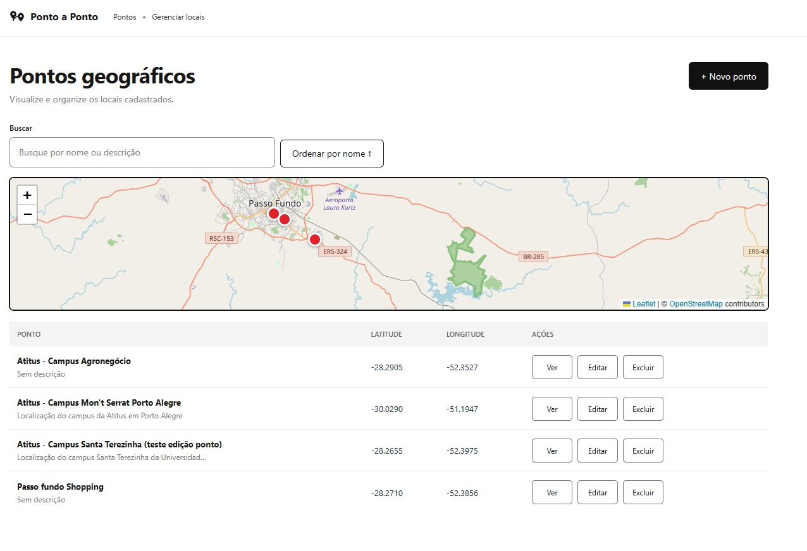
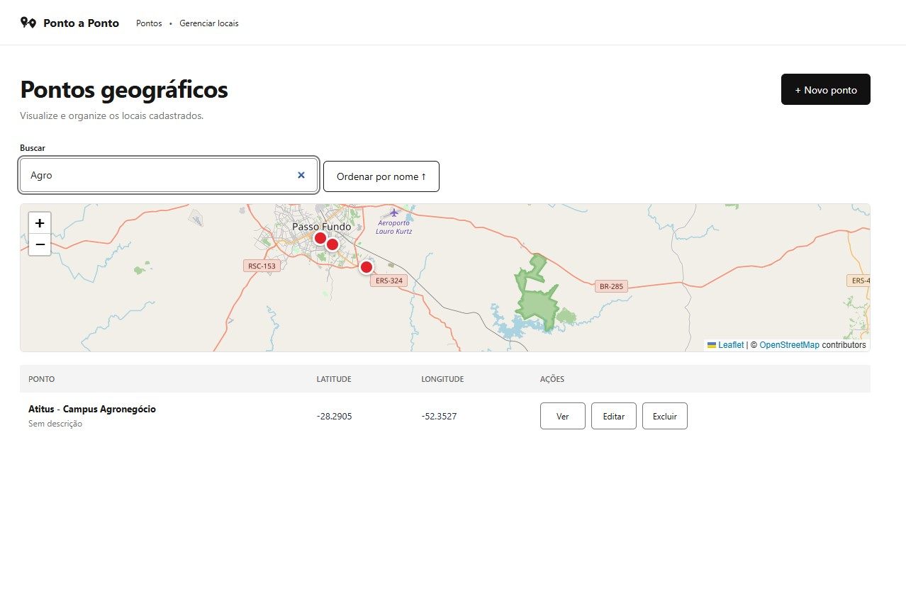
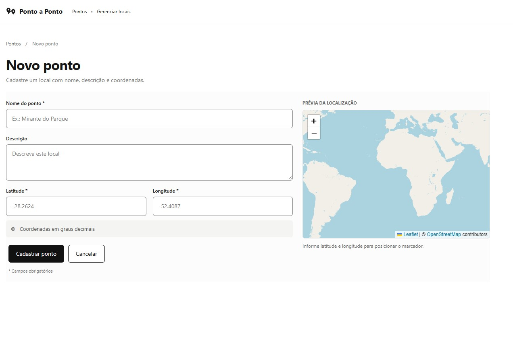
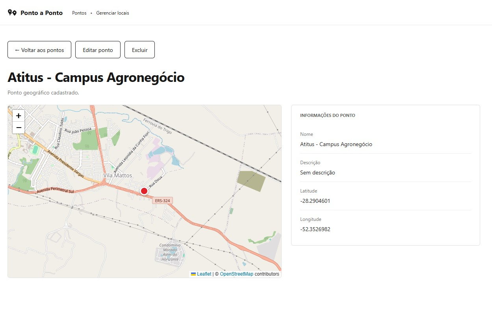
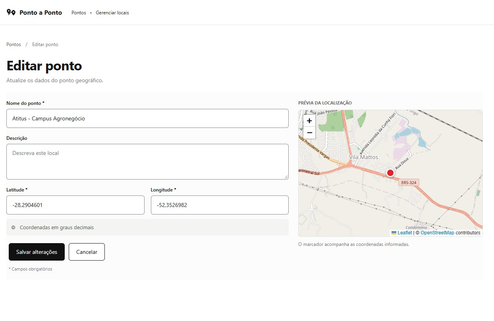

# Ponto a Ponto

Aplicação web para cadastrar, consultar, editar e excluir pontos geográficos. O front-end consome a API GeoPoint e exibe os locais em um mapa interativo.

## Integrantes

- **Lucas A. C. Castelli** — RA: 1139217
- **Rodolpho Simaenski** — RA: 1139959

## Tecnologias

- React
- Vite
- React Router
- Leaflet
- OpenStreetMap

## Funcionalidades

- Listar pontos geográficos cadastrados na API.
- Filtrar a lista por nome ou descrição e ordenar por nome.
- Cadastrar pontos com nome, descrição e coordenadas.
- Consultar os detalhes de um ponto.
- Editar e excluir pontos.
- Visualizar no mapa os pontos recebidos da API.

## Requisitos

- Node.js e npm instalados.
- Acesso à internet para conectar à API e carregar os mapas do OpenStreetMap.

## Como executar

No terminal, acesse a pasta `PontoaPonto` e execute:

```bash
npm install
npm run dev
```

Abra no navegador o endereço informado pelo Vite, normalmente `http://localhost:5173`.

Para gerar a versão de produção:

```bash
npm run build
```

## API utilizada

URL base: <https://apigeopoint.onrender.com/api/points>

| Método | Endpoint | Operação |
| --- | --- | --- |
| `GET` | `/api/points` | Listar pontos |
| `GET` | `/api/points/{id}` | Consultar um ponto |
| `POST` | `/api/points` | Cadastrar um ponto |
| `PUT` | `/api/points/{id}` | Atualizar um ponto |
| `DELETE` | `/api/points/{id}` | Excluir um ponto |

Os pontos usam os campos `name`, `description`, `latitude` e `longitude`. A latitude deve estar entre -90 e 90, e a longitude entre -180 e 180. O mapa posiciona os marcadores com as coordenadas retornadas pela API.

## Rotas do front-end

| Rota | Tela |
| --- | --- |
| `/pontos` | Listagem e filtro dos pontos |
| `/pontos/novo` | Cadastro de ponto |
| `/pontos/:id` | Detalhes do ponto |
| `/pontos/:id/editar` | Edição do ponto |

## Estrutura principal

```text
src/
├── components/   # Cabeçalho e mapa
├── pages/        # Listagem, formulário e detalhes
├── services/     # Chamadas à API
├── App.jsx       # Rotas da aplicação
└── main.jsx      # Inicialização do React
```

## Capturas de tela

### Listagem de pontos



### Filtro de pontos



### Cadastro de ponto



### Detalhes do ponto



### Edição de ponto


